<div align="center">

# Pi Web Seeker

**pi coding agent 的浏览器界面**

v0.6.25 · MIT

浏览会话 · 流式对话 · 模型与工具管理 · 工作区预览 · 受控远程分析


</div>

---

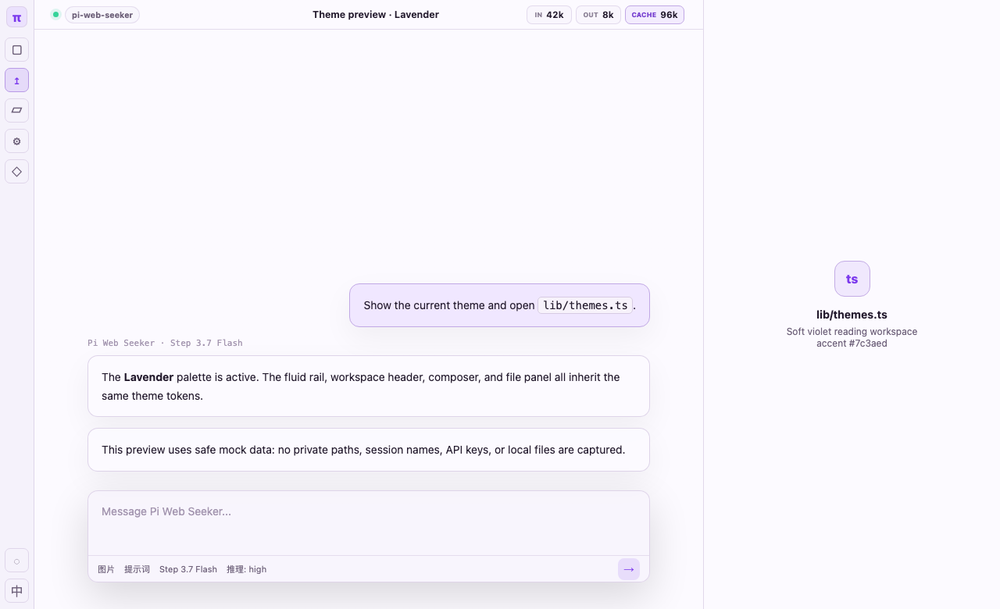

Pi Web Seeker 把 [pi coding agent](https://github.com/earendil-works/pi) 的本地会话、模型配置和扩展能力搬进浏览器，让你在一个网页里完成会话浏览、流式对话、模型与工具管理、工作区文件预览，以及对 SSH / Telnet 目标的受控只读分析。

> **定位说明**
> 本项目是 UI 与运行时编排层。真正的模型调用、会话持久化和工具执行由上游 `@earendil-works/pi-coding-agent` 与 `@earendil-works/pi-ai` 完成。

> **安全提示**
> 默认仅监听本机 `localhost`。需要局域网访问时，显式绑定非 loopback 地址并设置 `PI_WEB_ACCESS_TOKEN`；Model 与 Remote 等能力可以执行命令并读取文件，请只授予必要的工作区和目标权限。

## 目录

- [概览](#概览)
- [功能说明](#功能说明)
  - [会话与对话](#会话与对话)
  - [输入与编辑器](#输入与编辑器)
  - [模型与上下文](#模型与上下文)
  - [工作区与文件](#工作区与文件)
  - [Quick Chat](#quick-chat)
  - [SSH / Telnet 远程分析](#ssh--telnet-远程分析)
  - [Plan Mode 与 Buddy 审查](#plan-mode-与-buddy-审查)
  - [扩展能力](#扩展能力)
  - [导入导出](#导入导出)
  - [界面](#界面)
- [技术路径](#技术路径)
  - [技术栈](#技术栈)
  - [请求链路](#请求链路)
  - [目录结构](#目录结构)
  - [状态分层](#状态分层)
  - [关键实现约定](#关键实现约定)
  - [运行与部署形态](#运行与部署形态)
- [快速开始](#快速开始)
- [开发](#开发)
- [安全边界](#安全边界)
- [文档](#文档)

## 概览

Pi Web Seeker 面向希望在浏览器里使用 Pi 的开发者。它的核心设计把两件事严格分开：**浏览历史只读解析 JSONL，不创建 Agent 实例；只有发送消息时才启动进程内的 `AgentSession`**。

<div align="center">

| 你会得到什么 | 它如何工作 |
| :--- | :--- |
| 在浏览器里继续任何一个历史会话 | 直接读取 `~/.pi/agent/sessions/**/*.jsonl`，零副作用 |
| 逐字看到 Agent 的推理与工具调用 | 进程内 `AgentSession` + SSE 事件流，刷新后自动重连 |
| 对多台服务器做安全的只读排查 | 用户预建 SSH / Telnet 目标，Agent 只能引用 `profileId` |
| 在模型之间快速试问 | Quick Chat 直连模型，不加载工具与扩展 |

</div>

## 功能说明

### 会话与对话

| 能力 | 说明 |
| :--- | :--- |
| **会话浏览** | 直接解析 pi 的 `.jsonl` 会话文件，按工作目录分组，父子与分叉会话呈树状展示 |
| **流式对话** | 发送消息时才创建或复用进程内 `AgentSession`，通过 SSE 流式返回 |
| **断线重连** | 刷新页面时自动重连正在运行的事件流，不中断生成 |
| **分叉与分支** | 会话分叉生成子文件；会话内分支在同一文件内切换 leaf |
| **历史节点** | 支持从任意历史节点继续，也可手动压缩上下文 |

### 输入与编辑器

- 图片上传与粘贴
- 提示词片段与输入历史回溯
- 按会话保存草稿，切换会话不丢失
- Agent 运行中发送引导（steer）和补充指令

### 模型与上下文

| 能力 | 说明 |
| :--- | :--- |
| **模型管理** | Provider、model、API key、OAuth 登录集中配置于 `~/.pi/agent/models.json` 与 `auth.json` |
| **推理控制** | thinking level 切换，工具预设 Off / Low / High |
| **连通性测试** | 发起真实轻量请求验证模型可用性 |
| **上下文统计** | token、cache、cost、context 使用率实时展示，支持查看 system prompt |

### 工作区与文件

- 侧边栏工作区选择：本机访问使用系统原生目录选择器，远程或 Docker 环境使用网页目录浏览器
- 文件树浏览、文件名搜索，Git tracked 文件优先展示
- 代码高亮、Markdown 渲染（含 KaTeX 数学公式）、HTML、图片和音频预览
- 所有文件访问经过 allowed-roots 校验，并阻断通过 symlink 逃逸到工作区之外

### Quick Chat

悬浮的轻量对话面板，通过 `pi-ai` 直接调用模型，**不创建 `AgentSession`、不加载工具和扩展**，适合快速提问。

- 可选联网搜索（Tavily），单次请求只做一次有界搜索，最多返回 5 条净化后的来源
- 搜索凭据只保留在服务端，前端只能看到来源与状态元数据
- 临时历史和联网开关只存在当前浏览器标签；选择"转正式"后写入标准 `.jsonl` 会话

### SSH / Telnet 远程分析

Remote 面板为每个正式会话维持最多一个活动连接，Agent 工具和人工终端共用同一条会话级连接。

<table>
<tr><th align="left">维度</th><th align="left">行为</th></tr>
<tr><td><b>目标管理</b></td><td>目标（profile）由用户预先创建，Agent 只能引用 <code>profileId</code>，不能自行指定主机或凭据</td></tr>
<tr><td><b>凭据处理</b></td><td>密码与私钥口令只在连接期间驻留内存，请求结束后立即清除，不写入 <code>remote-targets.json</code></td></tr>
<tr><td><b>连接验证</b></td><td>SSH 首次连接显示 SHA-256 主机指纹，指纹变化时硬阻断；Telnet 每次连接提示明文传输风险</td></tr>
<tr><td><b>命令策略</b></td><td>按目标类型（Linux / FreeBSD / Windows / Cisco / 通用网络 / 自定义）应用只读白名单，无法分类的命令默认需要审批</td></tr>
<tr><td><b>人工接管</b></td><td>支持 Take control，接管会中止当前 Agent 命令，交还后自动执行恢复</td></tr>
<tr><td><b>输出捕获</b></td><td>输出进入有界敏感捕获库（默认上限 256 MiB、保留 30 天、LRU 清理），导出到工作区需逐次审批</td></tr>
</table>

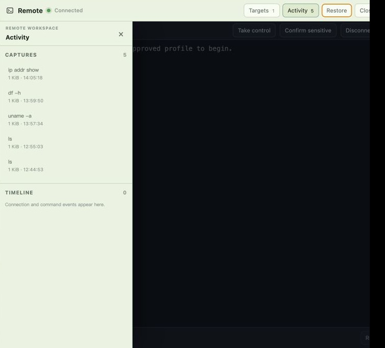

### Plan Mode 与 Buddy 审查

| 模式 | 行为 |
| :--- | :--- |
| `/plan` | 主 agent 进入只读计划模式，输出可渲染为 PlanCard 的计划 |
| `/normal` | 恢复进入计划模式前的工具集和 system prompt |
| `/plan-subagent` | 可选增强模式，需要 `pi-subagents` 提供的 `Agent` 和 `get_subagent_result` 工具 |
| Buddy · `plan` | 主 agent 与审查者都保持只读 |
| Buddy · `code` | 主 agent 保留编码工具，审查者只能发起一次前台 `Plan` 子智能体调用 |

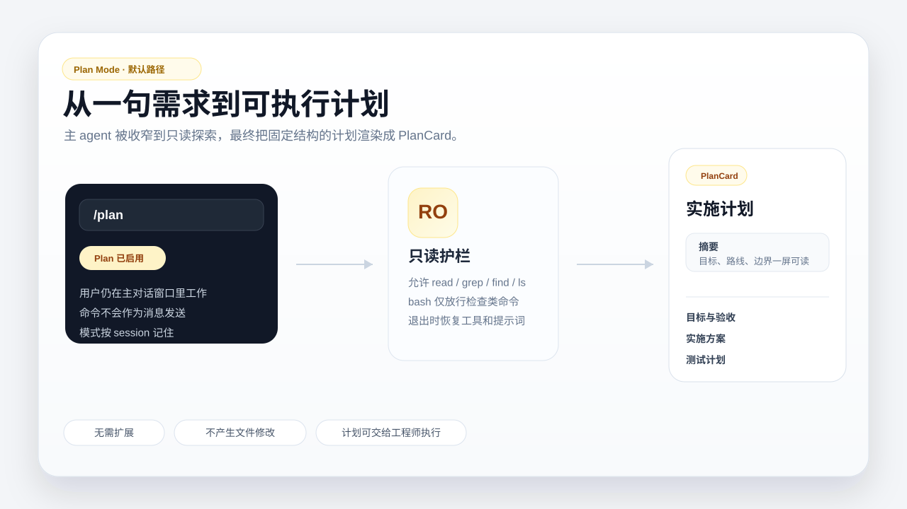

### 扩展能力

| 扩展 | 说明 |
| :--- | :--- |
| **Skills** | 发现、安装和启用 Codex skills |
| **Subagents** | 渲染 subagent 完成通知（agent 类型、状态、turns、tokens、耗时、transcript 信息） |
| **AGENTS.md 助手** | 新工作区缺少 `AGENTS.md` 时生成草稿，已有文件时可运行检查；草稿仅在页面预览，确认后才写入 |
| **模块化语言检查器** | 按需运行 Python、Java、C/C++、Go、Rust 本机检查器；显式确认，不自动安装或修复 |
| **coms-net / Pi Pi** | 内置 `pi-coms-net` 包，通过 HTTP/SSE hub 让不同机器、工作目录或 Pi 进程协作；`query_experts` 并行调用专家模板 |
| **受控浏览器** | 内置 `pi-opencli` 包，把受限工具动作映射为固定 OpenCLI 参数，操作本机已登录的真实 Chrome 标签页；敏感动作需审批 |

### 导入导出

- **普通导出**：Markdown / JSON 会话导出与导入
- **Debug Bundle**：以 `.tar.gz` 打包会话、媒体、工作区快照和脱敏诊断信息，用于跨机器复现问题
- **安全导入**：分 inspect 与 import 两步，先校验并展示 sandbox 目标、文件数量和警告，确认后才恢复

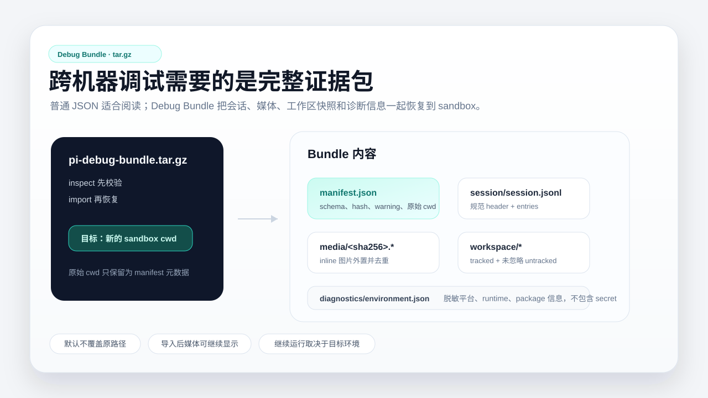

### 界面

<div align="center">

| [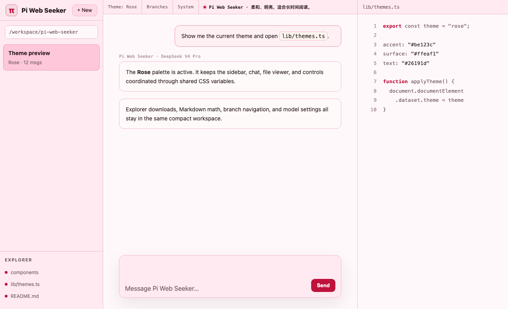](#) | [](#) | [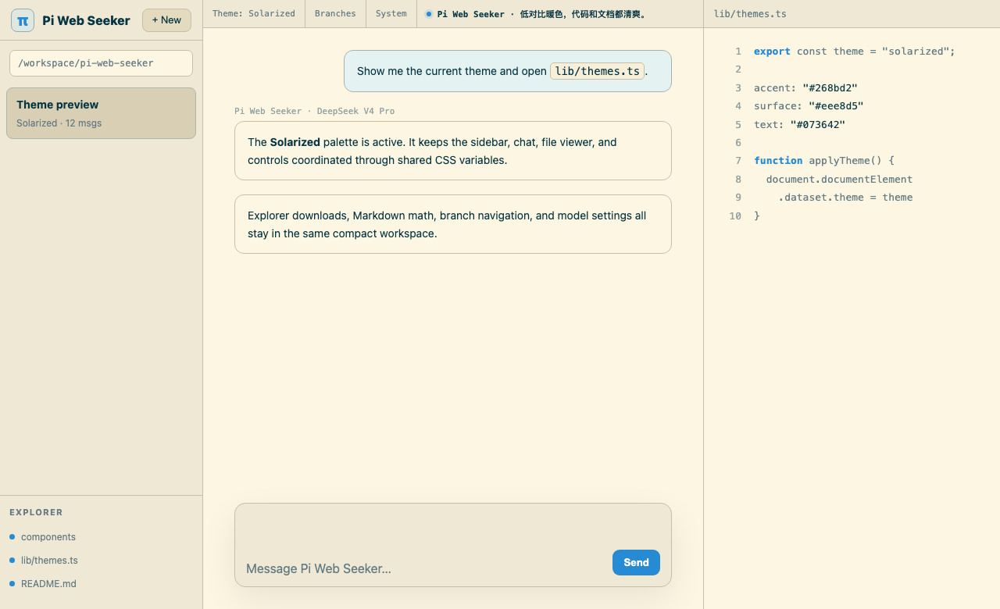](#) |
| :---: | :---: | :---: |
| **Rose** · 浅色 | **Lavender** · 浅色 | **Solarized** · 浅色 |
| [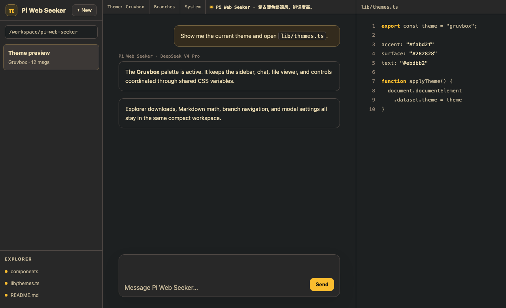](#) | [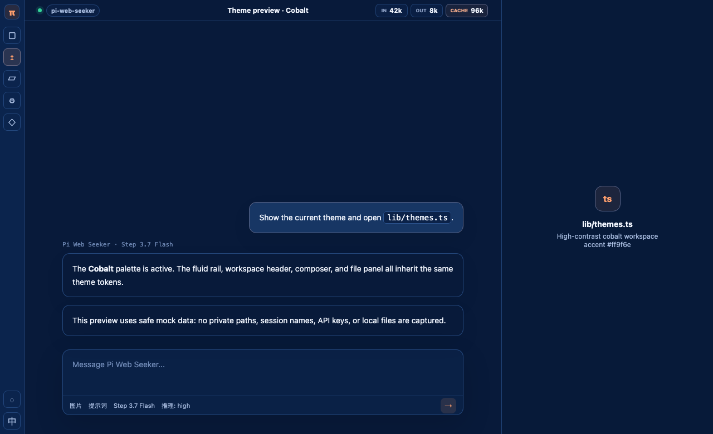](#) | [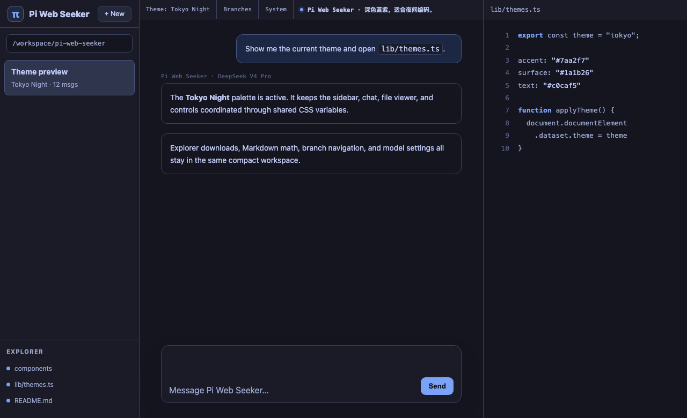](#) |
| **Gruvbox** · 深色 | **Cobalt** · 深色 | **Tokyo** · 旧主题 |

</div>

> 展示图为代表性主题。Tokyo 截图为旧版本，当前版本已把该主题映射到 Ink。

- **双语**：English / 简体中文实时切换
- **10 套主题**：mist · ink · sage · rose · midnight · solarized · gruvbox · catppuccin · lavender · cobalt
- **双布局**：Classic 传统布局与 Fluid 抽屉式布局（默认 Fluid）
- 长会话懒渲染，流式输出不影响历史消息
- 滚动 Minimap，快速定位长对话
- 流式输出指标（TPS、耗时、block 转换）

## 技术路径

### 技术栈

| 层 | 选型 |
| :--- | :--- |
| **框架** | Next.js 16.3.1（App Router、Route Handlers） |
| **UI** | React 19.2 · TypeScript 6（`strict: true`）· Tailwind CSS 4 |
| **运行时** | Node.js 22.19.0+（开发与构建使用 24.18.0） |
| **智能体内核** | `@earendil-works/pi-coding-agent` 0.84.1 · `@earendil-works/pi-ai` 0.84.1 |
| **渲染** | react-markdown + remark-gfm / remark-math + rehype-katex · react-syntax-highlighter |
| **远程** | ssh2 · telnet-client |
| **终端** | @xterm/xterm · @xterm/addon-fit |
| **测试** | node:test + `--experimental-strip-types` |

### 请求链路

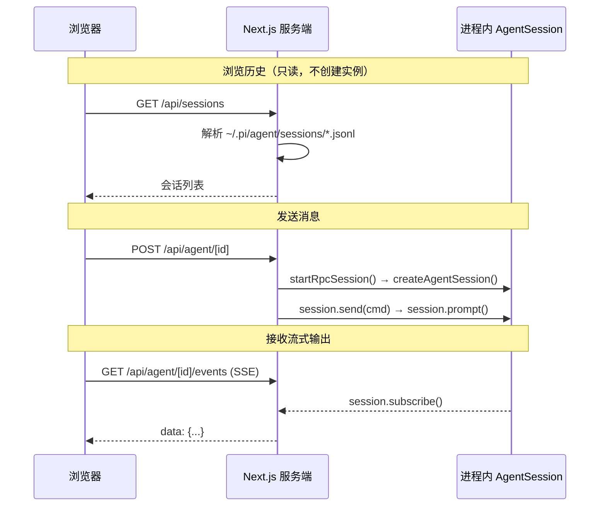

会话浏览是纯读取路径，通过 `lib/session-reader.ts` 解析 JSONL，不产生 `AgentSession`。只有发送消息时才通过 `lib/rpc-manager.ts` 的 `startRpcSession()` 创建或复用 `AgentSessionWrapper`。

> 这条分界是整个项目最重要的设计约束：**浏览历史的代价和发起对话的代价被彻底分开**。

### 目录结构

```
app/            Next.js App Router 页面与 Route Handlers（约 55 个 API 路由）
components/     UI 组件，按 AppShell / chat-input / chat-window / message-view 分区
hooks/          useAgentSession 及其子控制器
lib/            共享逻辑：会话解析、RPC 管理、安全校验、导出、类型
pi-packages/    内置 pi 扩展包（opencli / remote-exec / coms-net）
scripts/        构建、AGENTS.md 助手、coms-net 服务端等工具
tests/          基于 node:test 的状态与行为测试
docs/           用户指南、功能指南、架构笔记
```

### 状态分层

前端刻意按**更新频率**而非功能模块分层，避免每 token 的流式更新触发整页重渲染：

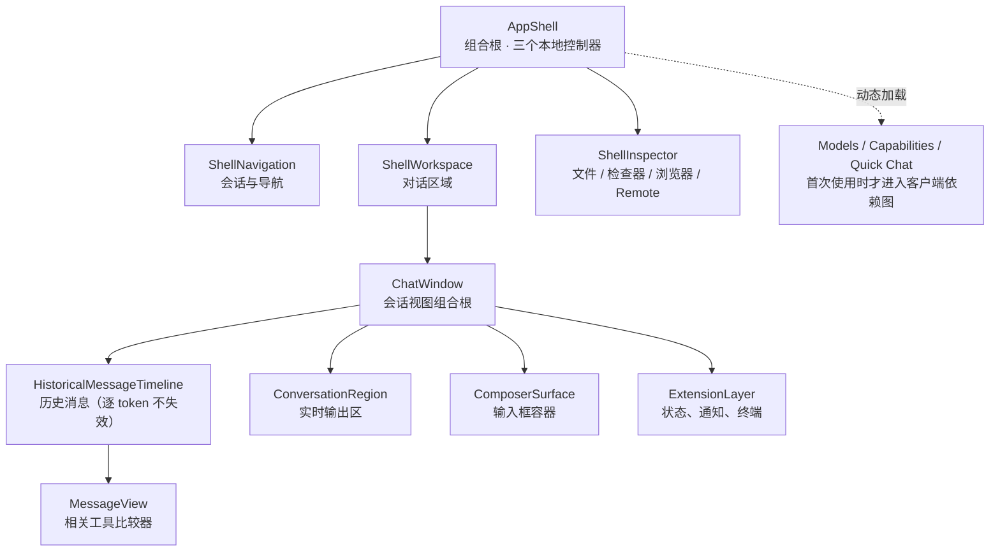

- `AppShell` 连接 session/workspace、导入、inspector 三个本地控制器和三块 memo 化视图区域，不使用 Context 或全局 store
- `MessageView` 只在该消息自身引用到的 `toolCallId` 状态变化时才重渲染
- `useAgentSession` 拆成数据、偏好、运行时、命令、滚动五个控制器，用 session 身份 + 单调递增 generation 作为生命周期闸门，过期响应不能写入可见状态
- Browser、Remote、Models、Capabilities 与 Quick Chat 体通过动态 import 隔离，不进入首屏客户端依赖图

### 关键实现约定

| 约定 | 原因 |
| :--- | :--- |
| **`globalThis` 缓存** | `__piSessions`、`__piStartLocks` 等挂在 `globalThis`，因为 Next.js 热重载会重建模块级变量，而运行中的 AgentSession 必须存活 |
| **工具调用归一化** | pi 存储为 `{ id, name, arguments }`，UI 期望 `{ toolCallId, toolName, input }`，文件加载与流式两条路径都要调用 `normalizeToolCalls()` |
| **路径安全** | `lib/allowed-roots.ts` 先 `realpath` 再比较，Windows 与 POSIX 分别处理并统一大小写与分隔符，symlink 无法逃逸 |
| **访问控制** | `proxy.ts` 提供可选令牌网关，支持 Bearer、`x-pi-web-token` 请求头和 query token 换取 HttpOnly cookie |
| **事件兼容** | 同时接受 `compaction_start/end` 与旧版 `auto_compaction_start/end` |
| **分叉语义** | `AgentSession.fork()` 原地修改 wrapper 内部状态，fork 后必须销毁 wrapper 让原会话干净重载 |

### 运行与部署形态

| 形态 | 说明 |
| :--- | :--- |
| **源码本地运行** | `npm run dev`，默认 `localhost:30141` |
| **Docker** | Compose 挂载 `.pi-web-data`（数据）、`.pi-web-workspace`（工作区）、`~/.ssh`（只读），支持单工作区模式 |
| **便携版** | Windows x64、macOS Apple Silicon / Intel，内置 Node.js 运行时 |

## 快速开始

> **前置要求**：Node.js **22.19.0** 或更高版本

### 从源码启动

克隆项目后，在项目目录运行：

```bash
npm install
npm run dev
```

打开 http://localhost:30141，在 Models 面板配置 provider 与 API key，然后在侧边栏选择工作区即可开始对话。

### Docker

Docker Compose 会启动服务并把用户数据、工作区与 SSH 配置挂载进容器：

```bash
PI_WEB_ACCESS_TOKEN=<long-random-token> docker compose up --build
```

默认挂载：

| 宿主机 | 容器 | 用途 |
| :--- | :--- | :--- |
| `.pi-web-data` | `/home/piweb/.pi` | 会话、模型、凭据与设置 |
| `.pi-web-workspace` | `/workspace` | 默认工作区 |
| `~/.ssh` | `/home/piweb/.ssh:ro` | 只读 SSH 配置 |

Docker 容器对外监听，因此必须设置访问令牌；未设置时 Compose 会拒绝启动。

### 监听地址与访问令牌

默认仅监听 `localhost:30141`，本机打开 http://localhost:30141。绑定到局域网地址时，必须同时配置访问令牌。以下命令从源码目录启动已构建的版本，首次运行前执行 `npm run build`：

```bash
npm run build
node bin/pi-web.js --port 8080
LAN_IP="<your-lan-ip>"
PI_WEB_ACCESS_TOKEN=<long-random-token> node bin/pi-web.js --hostname "$LAN_IP"
```

PowerShell：

```powershell
$env:PI_WEB_BIND_HOST = "<your-lan-ip>"
$env:PI_WEB_ACCESS_TOKEN = "<long-random-token>"
node bin/pi-web.js --hostname $env:PI_WEB_BIND_HOST
```

cmd.exe：

```bat
set "PI_WEB_BIND_HOST=<your-lan-ip>"
set "PI_WEB_ACCESS_TOKEN=<long-random-token>"
node bin/pi-web.js --hostname %PI_WEB_BIND_HOST%
```

**非 loopback 监听没有令牌时会直接拒绝启动。**

```bash
PI_WEB_ACCESS_TOKEN=<long-random-token> node bin/pi-web.js
```

首次通过 `http://<host>:30141/?token=<token>` 访问后，服务端会写入 HttpOnly cookie 并跳转回普通页面。令牌会短暂出现在首次请求 URL 中，且 HTTP 不加密令牌；不要在不可信网络直接暴露服务，局域网部署应使用 HTTPS 反向代理。API 客户端也可以使用 `Authorization: Bearer <token>` 或 `x-pi-web-token` 请求头。

## 开发

```bash
git clone git@git.staff.sina.com.cn:it/piweb-seeker.git
cd piweb-seeker
npm install
npm run dev
```

项目官方使用 Node.js 24.18.0；`engines` 要求 ≥ 22.19.0。开发服务器默认仅监听 `localhost:30141`。如需从局域网访问：

```bash
LAN_IP="<your-lan-ip>"
PI_WEB_BIND_HOST="$LAN_IP" PI_WEB_ACCESS_TOKEN=<long-random-token> npm run dev
```

### 目录导览

| 路径 | 职责 |
| :--- | :--- |
| `app/api/` | Route Handlers：会话、Agent、文件、Remote、Browser、Skills 等 |
| `components/` | UI；`app-shell/`、`chat-input/`、`chat-window/`、`message-view/` 按职责分区 |
| `hooks/` | `useAgentSession` 及其数据、运行时、命令、滚动控制器 |
| `lib/` | `session-reader`（只读解析）、`rpc-manager`（运行时）、`allowed-roots`（路径安全） |
| `pi-packages/` | 内置扩展：`pi-opencli`、`pi-remote-exec`、`pi-coms-net` |

更完整的文件地图见[架构笔记](docs/agent-notes/architecture.md)。

### 常用检查

```bash
node_modules/.bin/tsc --noEmit          # 类型检查
npm run typecheck                       # CI 同款类型检查
npm run lint                            # ESLint
npm test                                # 全量测试
npm run test:remote                     # Remote 行为测试
node scripts/agents-md.mjs check --path AGENTS.md   # 开发约定校验
```

此外还有按模块拆分的测试：`npm run test:app-shell`、`test:chat-input`、`test:message-view`、`test:chat-window`、`test:agent-session`、`test:agent-events`、`test:extension-ui`、`test:buddy`、`test:model-runtime`。

### 构建

```bash
npm run build
```

构建器默认 Windows 用 Turbopack、macOS / Linux 用 webpack，可通过 `--turbo`、`--webpack` 或环境变量 `PI_WEB_BUILD_ENGINE` 切换。

> 日常开发**不需要**运行 `next build`——它会污染 `.next` 并可能影响正在运行的开发服务器。

## 安全边界

- API key、`auth.json`、会话数据、`.env*`、Remote 捕获和私有路径都不应提交到仓库或出现在截图中
- 文件 API 校验 allowed roots，并阻断 symlink 逃逸
- Debug Bundle 包含会话和选中的工作区文件；文件名过滤只是启发式排除，不是对文件内容的完整秘密扫描，分享前应检查归档
- Remote 凭据只在内存驻留，终端输出、SSE、错误和时间线在写出前都做流式脱敏
- Plan Mode 会收窄工具并阻断明显的写入类 bash 命令，但**它不是操作系统级 sandbox**；处理不可信项目仍应使用容器或虚拟机

## 文档

| 文档 | 内容 |
| :--- | :--- |
| [用户指南](docs/user-guide.md) | 本地运行、工作区、构建与 Docker |
| [功能指南](docs/features.md) | Remote、Plan Mode、Debug Bundle 与扩展 |
| [架构与请求流](docs/agent-notes/architecture.md) | 文件地图与请求流 |
| [Pi Session 文件格式](docs/agent-notes/session-format.md) | `.jsonl` schema 与示例 |
| [开发约定](AGENTS.md) | 项目开发约定与陷阱 |

---

<div align="center">

**[MIT License](LICENSE)**

</div>